# Capstone 6: Resilient Container Platform & CI/CD

A containerized e-commerce backend on **Amazon ECS Fargate** across two Availability Zones, with **RDS MySQL Multi-AZ**, **ElastiCache Redis** caching, **SQS** decoupling with queue-depth auto scaling, **AWS Backup**, **Route 53 DNS failover** to a static S3 page, and a **CodePipeline/CodeBuild** pipeline that builds both images and rolls them out on every push to `main`.

All infrastructure is defined in **AWS CDK (TypeScript)** in [`infrastructure/`](infrastructure/).

- **Account / region:** 586481704498 / eu-west-1 (Ireland), AZs eu-west-1a and eu-west-1b
- **Stacks:** `ResilientCore` (network + data) and `ResilientApp` (containers, DNS, pipeline)
- **DNS record:** `shop.capstone-emmanuel.com` (hosted zone created for the lab; see [DR notes](#6-disaster-recovery-runbook))

---

## 1. Architecture

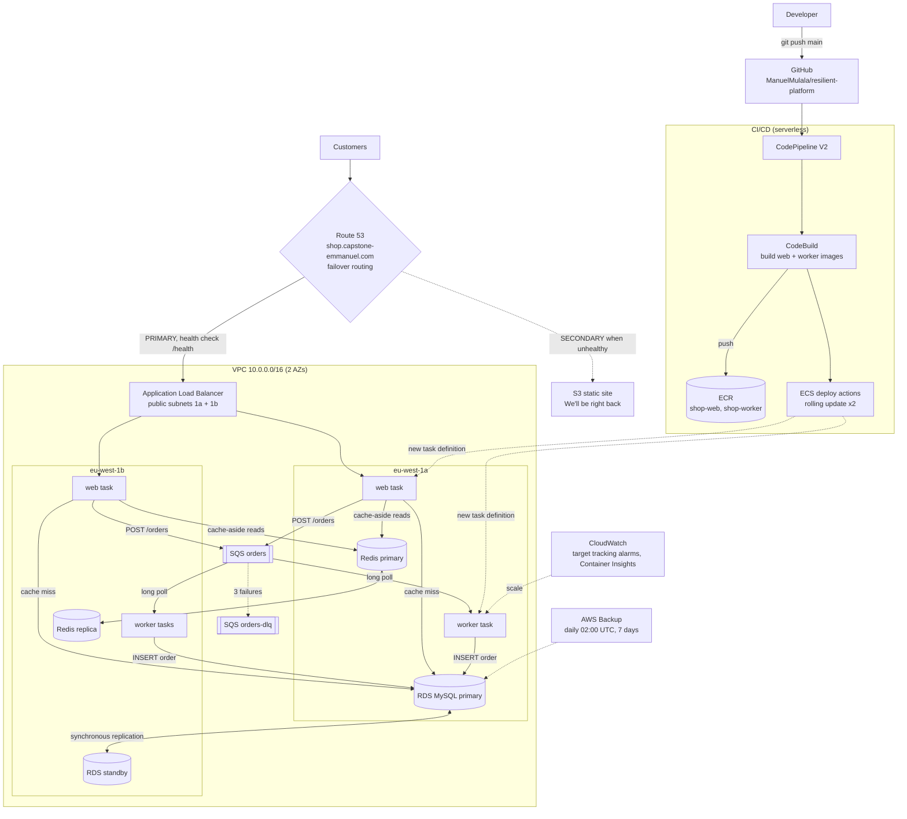

### Request flow

| Path | Flow | Why |
|---|---|---|
| `GET /products` | ALB → web → Redis; on miss → RDS → write to Redis (60 s TTL) | Cache-aside reduces DB load; `X-Cache: HIT/MISS` header shows which path served the request |
| `POST /orders` | ALB → web → SQS → **202 Accepted** | The web tier never waits on slow processing |
| Worker | Long-polls SQS (10 messages, 20 s wait) → ~500 ms work per order → `INSERT IGNORE` into RDS → delete message | Idempotent on `message_id`; failed messages retry and go to the DLQ after 3 attempts |
| `GET /health` | No DB dependency | Used by the ALB and Route 53; an RDS failover does not take the tasks out of service |

---

## 2. Repository layout

```
app/web/            Express API (products, orders, health) + Dockerfile
app/worker/         SQS consumer that writes orders to RDS + Dockerfile
pipeline/           buildspec.yml: builds and pushes both images, writes imagedefinitions per service
infrastructure/     CDK app
  bin/infrastructure.ts   Two stacks, eu-west-1
  lib/core-stack.ts       VPC, security groups, ECR, RDS Multi-AZ, Redis, SQS + DLQ, AWS Backup
  lib/app-stack.ts        ECS cluster, ALB, web + worker services, auto scaling, S3 + Route 53 failover, CodePipeline
  cdk.context.json        Pinned AZ list (lets synth run without an AWS lookup)
docs/screenshots/   Evidence
```

There is no `appspec.yml`: that file is only used for CodeDeploy blue/green deployments. This project uses **ECS rolling updates**, which are driven by the `imagedefinitions-*.json` files produced by CodeBuild.

---

## 3. High availability design

| Layer | Implementation | Failure it survives |
|---|---|---|
| Load balancer | ALB in public subnets in eu-west-1a and 1b | Loss of one AZ |
| Web tier | `shop-web`, 2 tasks minimum (one per AZ), scales 2–6 on CPU 60% and 300 requests/target | Task or AZ failure, traffic spikes |
| Worker tier | `shop-worker`, scales 1–5 on SQS queue depth | Order bursts |
| Deployments | Rolling update with `minHealthyPercent 100`, `maxHealthyPercent 200`, circuit breaker with automatic rollback | Bad releases |
| Database | RDS MySQL 8.4 `db.t4g.micro`, **Multi-AZ** (synchronous standby), credentials in Secrets Manager | Primary instance or AZ failure |
| Cache | ElastiCache Redis 7.1, primary + replica in different AZs, automatic failover | Cache node or AZ failure |
| Queue | SQS (regional, multi-AZ by design) + DLQ | Worker outages: messages wait instead of being lost |
| DNS | Route 53 failover: PRIMARY → ALB (health check), SECONDARY → S3 error page | Whole cluster offline |

**Network security:** internet → ALB:80 → tasks:3000 → RDS:3306 / Redis:6379, each hop allowed only from the previous security group. RDS and Redis sit in isolated subnets with no internet route. To avoid NAT gateway cost, tasks run in public subnets with public IPs, but their security group only accepts traffic from the ALB.

---

## 4. CI/CD pipeline

`resilient-platform` (CodePipeline V2): **Source** (GitHub via CodeConnections) → **Build** (CodeBuild, privileged Docker build of both images, tagged with the commit ID and `latest`, pushed to ECR) → **Deploy** (two ECS deploy actions in parallel: `RollingUpdateWeb`, `RollingUpdateWorker`).

**Proof of commit-triggered deployment:** commit `ea9dbad` "Release web v2 via pipeline" changed the web version from `v1` to `v2`. The pipeline ran without any manual step, `shop-web` moved to task definition revision 3 in **2 min 6 s** with 0/3 failed tasks, and `/health` then returned `"version":"v2"`.

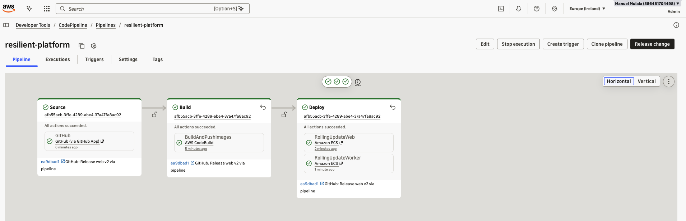
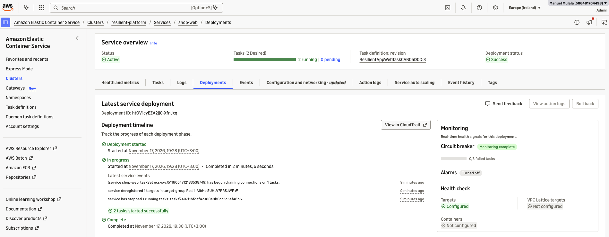

---

## 5. Performance and scaling evidence

### Caching and decoupling
First `/products` call: `X-Cache: MISS`, `source: database`. Second call: `X-Cache: HIT`, `source: cache`. A `POST /orders` was queued (202) and then appeared in `GET /orders` with `processed_by` set to a worker task.

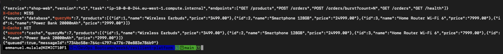

### Multi-AZ tasks
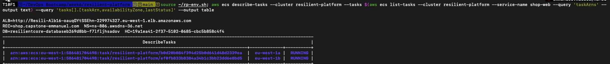

### Worker scaling on SQS queue depth
Target tracking keeps `ApproximateNumberOfMessagesVisible` at about **100 messages per task** (min 1, max 5). A burst of 2,000 orders was sent with `POST /orders/burst?count=2000`.

| Time (UTC) | Observed |
|---|---|
| 16:42 | Burst sent; queue depth jumps to ~1,950 |
| 16:47 | `TargetTracking ... AlarmHigh` fires; ECS sets desired count **1 → 5**, 5 tasks running |
| 16:51 | Queue fully drained |
| 17:00+ | Queue empty; scale-in back to 1 after the alarm's 15-minute low period |

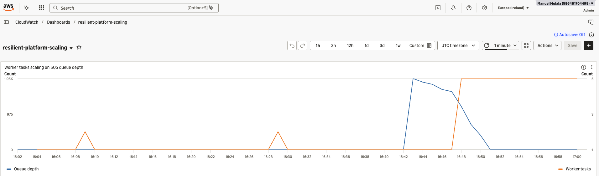
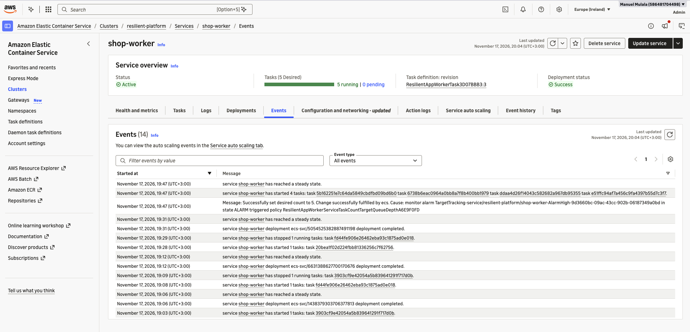

**Observation:** scale-out started about 4–5 minutes after the burst. SQS publishes queue metrics once a minute and the target-tracking alarm needs several breaching datapoints, so a queue-based policy reacts in minutes, not seconds. For faster reaction, step scaling on the same metric or a lower target value would help.

---

## 6. Disaster recovery runbook

### 6.1 AWS Backup
- **Plan:** `resilient-platform-daily`, rule `DailyRdsSnapshot`, cron `0 2 * * ? *` (02:00 UTC / 05:00 EAT), start within 1 h, complete within 3 h, **7-day retention**, vault `resilient-platform-vault`, resource assignment: the RDS instance. Defined in `infrastructure/lib/core-stack.ts`.
- **Validation:** two on-demand jobs were run with the plan's own role and vault; both **Completed** in about 4 minutes each (17:09–17:13 and 19:16–19:20 UTC).
- **Restore procedure:** AWS Backup → Vaults → `resilient-platform-vault` → recovery point → **Restore** → new DB instance in the same subnet group and security group → update the `DB_HOST` environment variable (or swap the DNS name) and redeploy the services.

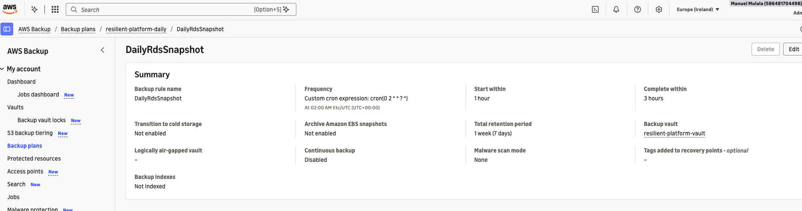
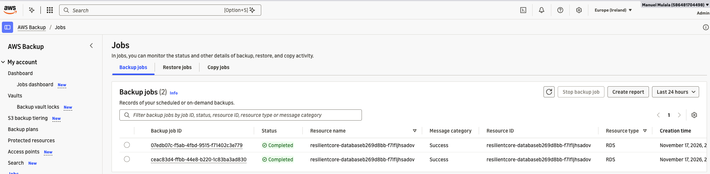

### 6.2 Route 53 failover test (cluster offline)
- **Setup:** health check `shop-alb-health` calls `http://<ALB>/health` every 10 s, unhealthy after 2 failures. PRIMARY alias → ALB (with the health check), SECONDARY alias → S3 website bucket `shop.capstone-emmanuel.com` serving a "We'll be right back" page.
- **Simulated failure:** the web service's scalable target was locked at 0 tasks.

| Time (UTC) | Event |
|---|---|
| before 18:21 | DNS → ALB (`18.202.109.185`, `54.220.173.64`), health check `HTTP 200` |
| 18:21:26 | `shop-web` scaled to 0 (min = max = 0) |
| by 18:23:46 | ALB returns 503, health check `Failure: HTTP 503`, DNS → S3 website IPs, page "We'll be right back" (**failover within 2 min 20 s**) |
| restore | Scalable target reset to 2–6, desired count 2 |
| 19:22:34 | DNS back on the ALB IPs, health check `Success: HTTP 200`: **automatic failback** |

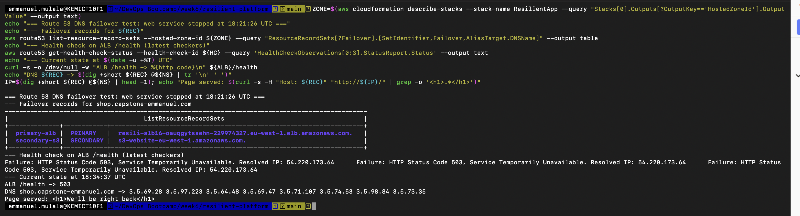
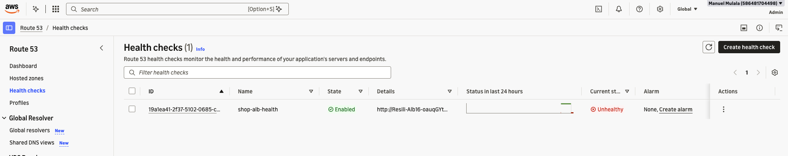
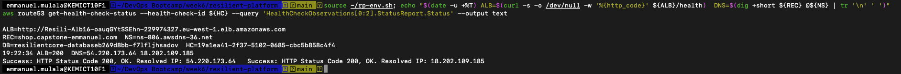

**Note on the domain:** `capstone-emmanuel.com` is not registered, so public resolvers do not use this zone. The failover was verified by querying the zone's authoritative name server directly (`dig @ns-806.awsdns-36.net`). With a registered domain delegated to these name servers, browsers would see the same switch.

### 6.3 RDS Multi-AZ failover test
Forced with `aws rds reboot-db-instance --force-failover` while a loop requested `/products` and `/orders` every 2 s.

| Time (UTC) | Event |
|---|---|
| 19:00:20 | Failover requested (primary eu-west-1b, standby eu-west-1a) |
| 19:00:35 | RDS: "Multi-AZ instance failover started" |
| 19:00:58 | RDS: "Multi-AZ instance failover completed" (**~23 s at the database**) |
| 19:00:35–19:02:43 | Application: 2 requests hung and returned **504** from the ALB; normal 200s resumed at 19:02:43 |
| after | Primary now **eu-west-1a**, standby **eu-west-1b** |

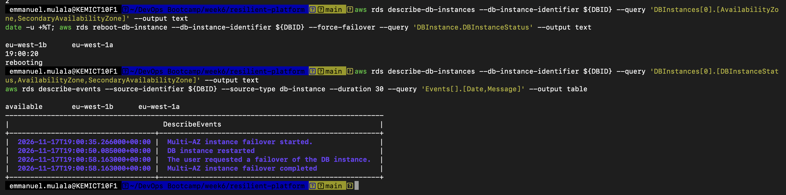
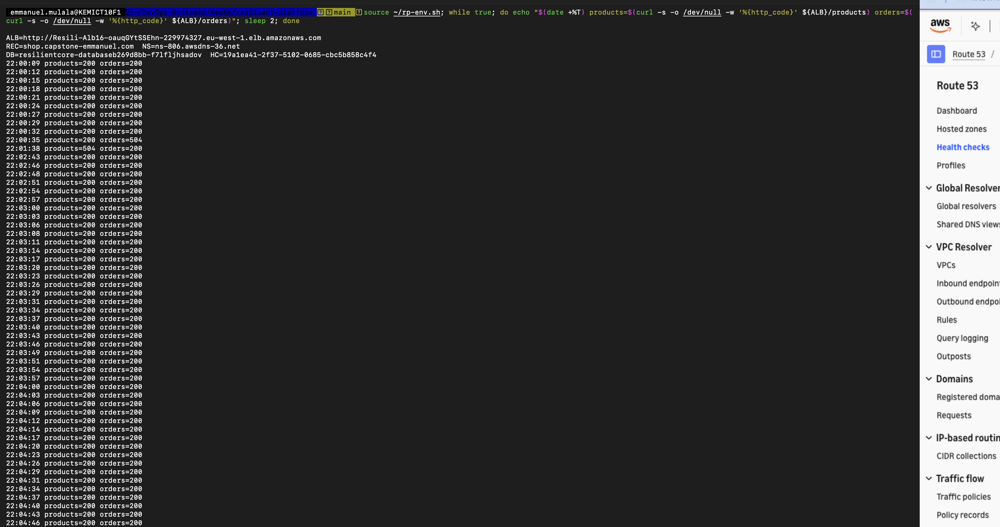
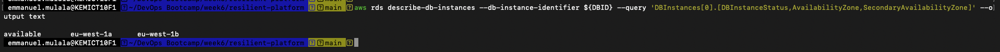

**Finding:** the database recovered in ~23 s, but the application was degraded for about **2 minutes**. The `mysql2` connection pool kept connections to the old primary, so requests waited until the ALB's 60 s idle timeout and returned 504. No data was lost and no task restarted. **Fix:** set `connectTimeout` (e.g. 5 s) and `enableKeepAlive` on the pool, and add a short per-query timeout so dead connections fail fast and are replaced. The health endpoint deliberately does not touch the DB, which is why ECS did not cycle the tasks during the failover.

### 6.4 Summary of recovery objectives (observed)

| Scenario | Detection | Recovery | Data loss |
|---|---|---|---|
| Web task / AZ failure | ALB health check, 2 × 15 s | ECS replaces the task; other AZ keeps serving | None |
| Whole cluster offline | Route 53 health check, 2 × 10 s | DNS to S3 error page within 2 min 20 s | None (orders accepted before the outage stay in SQS/RDS) |
| RDS primary failure | RDS Multi-AZ | DB ~23 s, app ~2 min (pool fix above) | None (synchronous standby) |
| Data corruption / deletion | n/a | Restore from AWS Backup (daily, 7 days) | Up to 24 h (RPO) |

---

## 7. Deploying from scratch

Prerequisites: Node.js 20+, Docker, AWS CLI v2, CDK bootstrapped in eu-west-1, a CodeConnections GitHub connection with status **Available**.

```bash
cd infrastructure
npm ci
# set connectionArn, repo, zoneName, recordName in cdk.json -> context
npx cdk deploy ResilientCore                 # VPC, RDS Multi-AZ, Redis, SQS, ECR, Backup (~15-20 min)

# first images (services need an image before they can start)
REG=586481704498.dkr.ecr.eu-west-1.amazonaws.com
aws ecr get-login-password --region eu-west-1 | docker login --username AWS --password-stdin $REG
docker build --platform linux/amd64 -t $REG/shop-web:latest ../app/web && docker push $REG/shop-web:latest
docker build --platform linux/amd64 -t $REG/shop-worker:latest ../app/worker && docker push $REG/shop-worker:latest

npx cdk deploy ResilientApp                  # ECS, ALB, scaling, Route 53, S3, pipeline
```

After this, every push to `main` builds and rolls out both services through the pipeline.

---

## 8. Lessons learned

1. **Database failover is faster than application recovery.** RDS switched in 23 s; the app took ~2 min because pooled connections were not timed out. Resilience needs client-side timeouts, not just a Multi-AZ setting.
2. **Health checks should not depend on the database.** Because `/health` only checks the process, ECS and Route 53 did not remove healthy tasks during the RDS failover, which would have turned a 23 s DB event into a full outage.
3. **Queue-depth scaling reacts in minutes.** SQS metrics are per minute and target tracking waits for several datapoints; size the minimum worker count for normal load and use scaling for bursts.
4. **Caching only protects reads while the entry is fresh.** `/products` is served from Redis on a hit, but during the RDS test one `/products` request still returned 504: the 60 s cache entry had expired, so the request fell through to the unreachable database. A longer TTL, or serving the stale cached value when the DB query fails, would keep reads up during a failover.
5. **Route 53 failover can be proved without buying a domain** by querying the zone's authoritative name servers.
6. **Pick supported engine versions.** MySQL 8.0 left RDS standard support in July 2026; using 8.4 avoids Extended Support charges.
7. **Pin context values for CDK behind a corporate proxy.** The AZ lookup during synth failed with a self-signed certificate error; committing `cdk.context.json` with the AZ list makes synth deterministic and offline.
8. **No NAT gateway, still locked down.** Public-subnet tasks with ALB-only ingress and isolated data subnets kept the lab affordable without exposing the containers.

---

## 9. Cleanup

```bash
# delete backup recovery points first, or the vault cannot be deleted
for rp in $(aws backup list-recovery-points-by-backup-vault --backup-vault-name resilient-platform-vault \
  --query 'RecoveryPoints[].RecoveryPointArn' --output text); do
  aws backup delete-recovery-point --backup-vault-name resilient-platform-vault --recovery-point-arn $rp
done
aws cloudwatch delete-dashboards --dashboard-names resilient-platform-scaling
cd infrastructure && npx cdk destroy ResilientApp ResilientCore
```
